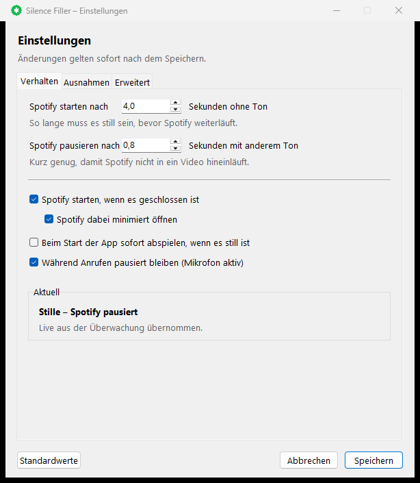

# Silence Filler

A small Windows tray app that keeps Spotify playing while the PC is quiet and pauses it as soon as something else makes noise.

I built this for a pretty specific annoyance: I'm listening to music, open a YouTube video, and Spotify keeps playing over it. Or I pause the video to read something, and the sudden silence is louder than the video was. Silence Filler handles that back and forth automatically. When another app starts playing audio, Spotify pauses. When everything goes quiet again for a few seconds, it picks up where it left off.



The settings window is in German, since that's the language I use it in. The code and this README are in English.

## What it does

- Watches the Windows audio mixer and checks the peak level of every app's audio session.
- After 4 seconds of silence, resumes Spotify.
- When another app starts playing audio, pauses Spotify after 0.8 seconds.
- While the microphone is in use (Discord, Teams, Zoom, etc.), Spotify stays paused even when nobody is talking.
- Starts Spotify if it isn't running.
- Lives in the system tray and has a settings window, so there's no config file to edit by hand.

No Spotify account, API key, or Premium subscription is involved. Playback is controlled through the same Windows media API (SMTC) that the play/pause keys on your keyboard use.

## Requirements

- Windows 10 or 11
- The Spotify desktop app (the web player doesn't expose SMTC controls)
- Python 3.10+ (developed on 3.12)

## Setup

```bat
setup.bat
```

This creates a virtual environment and installs the packages from `requirements.txt`.

To start it:

- `start.vbs` starts the app in the tray without a console window.
- `start-console.bat` runs it in a console with logging, which is useful while testing.
- `python app.py --no-tray --debug` runs it directly with verbose output.

### Autostart

```powershell
powershell -ExecutionPolicy Bypass -File .\install-autostart.ps1
```

This drops a shortcut into the user's Startup folder. To remove it:

```powershell
powershell -ExecutionPolicy Bypass -File .\uninstall-autostart.ps1
```

## Tray menu

- Current status (silent, audio playing, microphone in use, Spotify playing)
- Autofill on/off
- Play or pause Spotify manually
- Settings...
- Open log
- Quit

Double-clicking the tray icon also opens the settings window.

## Settings

Changes apply as soon as you hit Save. No restart needed.

**Behavior**

- How many seconds of silence before Spotify starts.
- How many seconds of other audio before Spotify pauses.
- Start Spotify when it's closed, and whether to start it minimized.
- Start playing immediately on launch if the PC is already silent.
- Stay paused while the microphone is in use.

**Exceptions**

- Apps whose audio and microphone use should never pause Spotify. Discord, Discord PTB, and Yapper are already in the list.
- The same list covers both audio and microphone. Spotify itself is always exempt.
- Windows system sounds (error beeps, notification dings) are ignored by default. The checkbox can turn that off.
- "Add..." shows a list of running programs, or you can type a process name.

**Advanced**

- Peak threshold and polling interval, in case detection is too sensitive or too slow.
- Path to `Spotify.exe`, if it's installed somewhere unusual.
- Quick actions: play/pause Spotify, open the log.

## Configuration

Settings are stored in `config.json` next to the app. You shouldn't need to touch it, but here's what's in there:

| Key | Default | Meaning |
|---|---|---|
| `silence_delay_seconds` | `4.0` | Seconds of silence before Spotify starts. |
| `pause_delay_seconds` | `0.8` | Seconds of other audio before Spotify pauses. |
| `audio_threshold` | `0.0015` | Peak level (0-1) that counts as "playing audio". |
| `poll_interval_seconds` | `0.25` | How often audio sessions are sampled. |
| `exception_processes` | Spotify, Discord, Discord PTB, Yapper, a few audio tools | Apps that never pause Spotify. |
| `launch_spotify_if_closed` | `true` | Start Spotify if it isn't running. |
| `spotify_path` | `%APPDATA%\Spotify\Spotify.exe` | Path to the Spotify desktop app. |
| `start_minimized` | `true` | Open Spotify minimized when the app starts it. |
| `pause_on_microphone` | `true` | Don't start Spotify while the mic is in use. |
| `ignore_system_sounds` | `true` | Ignore short Windows system sounds. |
| `start_playing_on_launch` | `false` | Start playing on launch if the PC is already silent. |

`config.json` is gitignored. On a fresh clone the app creates it with the defaults above.

## How it works

The app enumerates the audio sessions on the default output device through `IAudioSessionManager2` (via pycaw) and reads each session's peak meter. A session counts as "playing" when its peak goes above the threshold. The session's process ID is mapped to an executable name with psutil, which is what the exception list matches against.

Spotify is controlled through the Windows Global System Media Transport Controls (via winsdk). That's the same API the hardware media keys use, so no Spotify credentials are needed.

Microphone usage is detected the same way, but on the capture device. If any non-exempt process has an active capture session, the mic counts as busy.

A few details that matter in practice:

- Windows plays error and notification sounds in a special session with PID 0. It's ignored by default; otherwise every error beep would pause the music.
- Some tools (Voicemod, NVIDIA Broadcast, audio routing mods) keep a session or the microphone open all the time. They're good candidates for the exception list.
- Only the default output device is monitored. Audio playing on a second device isn't seen.

## Behavior notes

- The first launch doesn't start Spotify just because the PC is quiet. It waits for an audio-to-silence transition, so it won't surprise you at boot. This can be changed in the settings.
- If you pause Spotify yourself, it stays paused until the next audio-to-silence transition.
- If Spotify is already playing when the app starts, the app takes over and will pause it when other audio appears.
- During long pauses in a video (longer than the silence delay), Spotify can briefly start. Increase the silence delay if that's annoying.
- Only one instance can run at a time. A Windows mutex makes a second instance exit immediately.

## Troubleshooting

**Spotify doesn't start**

- Open Spotify manually and play a track once. After that the app can resume playback.
- Check `silence-filler.log`.

**Spotify doesn't pause when YouTube is playing**

- Make sure the browser isn't in the exceptions list.
- The log shows which app was detected as the audio source.

**Spotify starts during a Discord call**

- Discord and Discord PTB are exceptions by default. Remove them if you want Spotify to pause during calls.
- Look for `Microphone in use:` in the log. If another tool keeps the mic open (Voicemod, NVIDIA Broadcast, dictation software), add it to the exceptions.

**Tray icon is missing**

- Windows 11 hides new tray icons in the overflow menu (the arrow next to the clock) more often than it should.
- Run `start-console.bat` to see errors.

## Uninstall

1. Quit from the tray menu.
2. Remove the autostart entry (see above).
3. Delete the folder.
